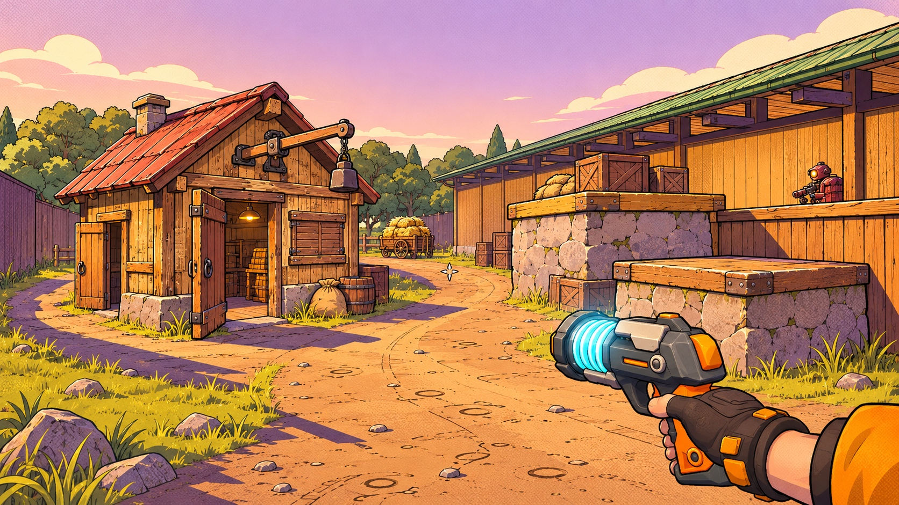

# 碎星群岛 · 第一人称卡通版

《碎星群岛》是一款在浏览器里玩的原创第一人称街机射击游戏。你扮演凯，从晨风镇出发，在浮岛间追踪抢粮的机器人车队。看清招式预警、借掩体换位，用枪托砸散机器人还能捡回它们抢走的补给。


*画风目标图。墨线轮廓、赛璐璐色阶和网点阴影保留漫画的质感。*

## 本地试玩

本地需要 Node.js 22.12 或更高版本和 pnpm。以下命令在仓库根目录运行。

```bash
pnpm install --frozen-lockfile
pnpm dev
```

在桌面浏览器打开 <http://localhost:5280>，从整备界面选择 **1-1「出发」**。进入关卡后点击画面锁定鼠标，按 `Esc` 暂停并释放鼠标。

| 操作 | 默认按键 |
| --- | --- |
| 移动 / 瞄准 | `W` `A` `S` `D` / 鼠标 |
| 射击 / 枪托近战 | 鼠标左键 / 右键 |
| 跳跃 / 冲刺闪避 | 空格 / `Shift` |
| 拾取 / 开宝箱 / 操作机关 | `F` |
| 技能 / 大招 | `Q`、`E` / `R` |
| 切换主武器和特殊武器 | `1`、`2` 或滚轮 |
| 地图 | `M` |

可在整备界面的设置里调整键位、视野角和眼高。

## 当前关卡

| 关卡 | 玩法与进度 |
| --- | --- |
| **1-1 出发** | 从镇口麦田出发，过风车坡、绕过晒谷场，迎战铁皮稻草人。第一人称样板关，可从开场打到结算。 [关卡说明](docs/design/levels/1-1.md) |
| **1-2 牧场** | 在羊圈和装车场之间推进，截下三辆运粮车，再到大谷仓迎战爆破头目。通关 1-1 后解锁，关卡画面和节奏持续迭代。 [关卡说明](docs/design/levels/1-2.md) |
| **1-3 废弃农庄** | 通关 1-2 后解锁。从村巷绕过盾兵，在麦地里潜行或截住跑去敲钟的守卫。穿过农舍院子、找到运粮单，再引铁盾队长撞上粮仓。 [关卡地图与实机画面](docs/design/levels/1-3.md) |
| **1-4、1-5 与试炼** | 已有关卡机制和 Boss 原型，第一人称场景按第 1 章的顺序推进。 [路线图](docs/plan/roadmap.md) |

重玩时可以选择携带的特殊武器与技能，完成关卡悬赏并积累经验。[第一人称玩法](docs/design/gameplay.md)

## 关卡概念图

| 1-1 风车坡 | 1-2 装车场 |
| --- | --- |
|  |  |
| 过桥后用缓坡或石台上行。 | 从地磅房穿行，或上货台改变射击角度。 |

## 开发

项目使用 TypeScript、Three.js 和 Vite。`src/data/` 定义关卡和玩法数据，`src/sim/` 以固定步长推进 2.5D 游戏逻辑，`src/render/` 和 UI 根据游戏状态绘制画面。 [技术架构](docs/tech/architecture.md)

| 命令 | 用途 |
| --- | --- |
| `pnpm typecheck` / `pnpm test` | 类型检查和 Vitest 用例 |
| `pnpm build` | 生成生产构建 |
| `pnpm e2e` | 使用本机 Chrome 跑浏览器回归 |
| `pnpm map draw 1-1 1-2 1-3` | 查看关卡布局、视线统计和校验结果 |
| `pnpm shots --spots 1-1-gate` | 截取固定机位 |

第一人称的关卡、美术与操作在本仓库维护。剧情、角色和世界观源自 [《碎星群岛》俯视版](https://github.com/chengzuopeng/shattered-isles)。

[文档索引](docs/README.md) · [美术素材](art/README.md) · [工程约定](AGENTS.md)
