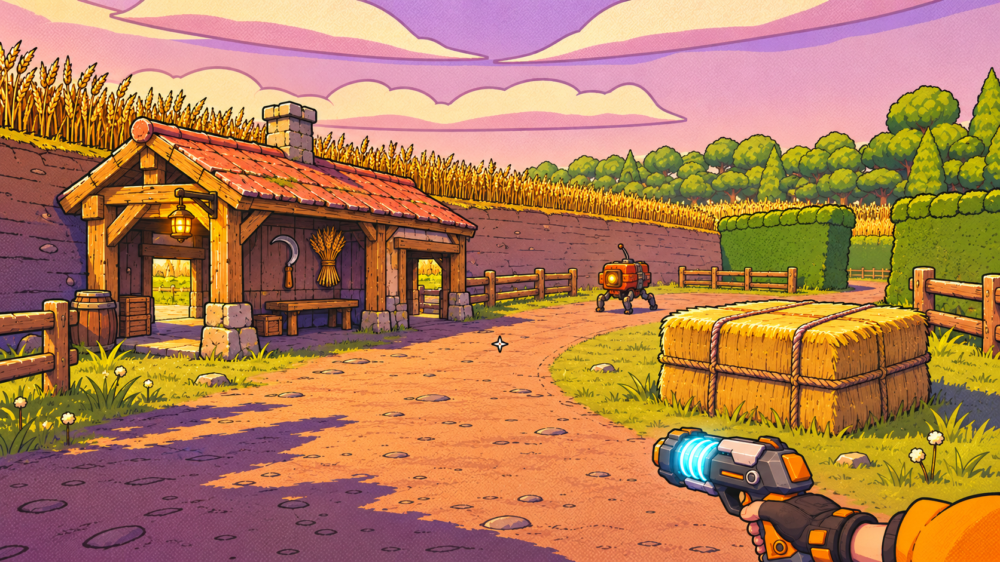
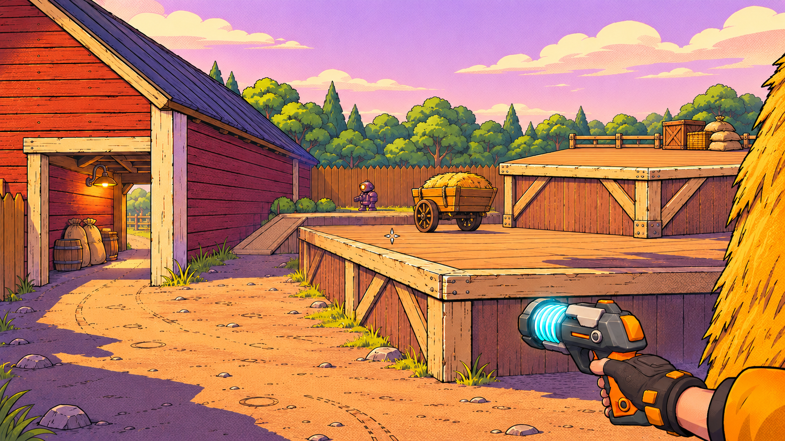
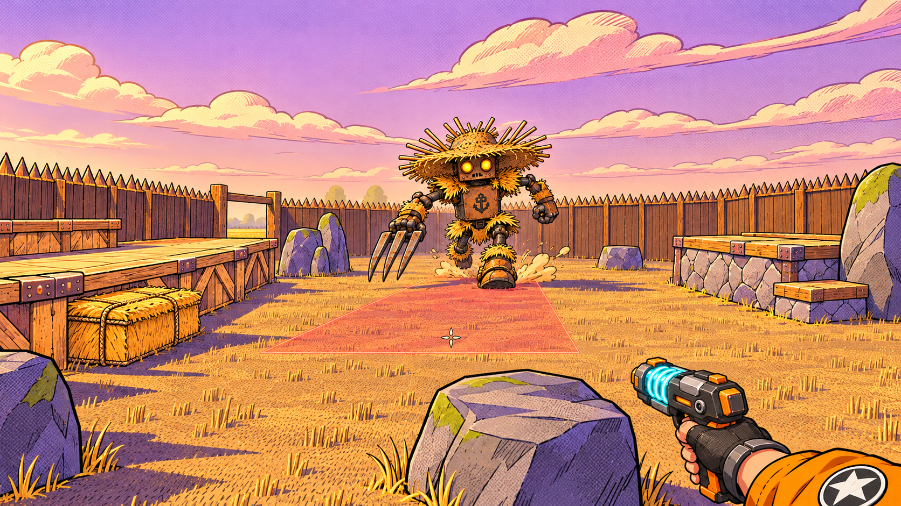

# 1-1 出发的掩体、穿行与跳台

2026-11-19 · 在现有晨风镇郊外布局上加了四处可选路线。小屋、台阶和台面用与牧场共用的程序几何，房门开口由地标占格控制，跳台落脚高度来自高度图。

下文用各区域内的 `(列, 行)` 坐标。每格一米，矩形含两端，台面高度以附近地面为基准。

## 镇口麦田

走出出生巷后，路左的农具棚占 `(8,18)–(13,21)`。南门占第 21 行的第 9、10 列，东门占第 13 列的第 19、20 行。转过屋内的工作台即可换边。路对侧 `(17,24)–(19,25)` 的平顶捆麦高 1 米，可以做一次基础跳跃再落回地面。捆麦摆在第 23 行巡逻路线的南侧，首个冲锋兵仍会从巷口外横穿。

## 风车坡

东桥过河后，主路沿北岸逐级上坡。坡右侧先跳上 `(52,34)–(54,35)` 的木边石台，再跳上 `(52,32)–(54,33)` 的石板台，分别高出桥头 1 米和 2 米。上层往西半米落差接到主坡，方便打完桥头敌人后继续往山脊走。

## 晒谷场

红谷仓南门面向入口，东侧第 34、35 行从第 10 列到第 12 列开通两格宽的通道，经过白色门框和灯即可接到谷仓东侧土路。玩家可以从一侧进屋、绕过室内箱子，从另一侧出去。

打谷台从 `(30,24)` 到 `(47,41)` 铺木面，台面高 1 米，西坡在第 29 列，东坡在第 48、49 列的第 31～33 行。外角 `(33,25)–(36,27)` 增设高 2 米的小木台，沿低台一侧敞开宽边，方便起跳、落地后再回到北路。

## 收割场

西边的踏捆占 `(17,20)–(19,21)`，高 1 米，可再跳上 `(16,16)–(18,19)` 的 2 米木台。北端沿第 15、14、13 行逐级降半米。东边 `(40,15)–(43,18)` 的木面石台高 1 米，第 19 行用半米踏步回到地面。

中央 `(23,14)–(35,23)` 留出 13 × 10 米平地供冲撞和横向躲避，四个召唤点在原地面高度。稻草人撞到西边高台会进入现有的撞停硬直。

## 关卡验证

| 实装测量 | 改造前 | 改造后 |
|---|---:|---:|
| 开门后的地面最短路 | 319 米 | 319 米 |
| 起点能看到的地面 | 208 格 | 149 格 |
| 起点能看到的敌人 | 0 | 0 |
| 沿主路同时可见敌人峰值 | 9 | 9 |
| 一次警报最多连带 | 5 | 5 |

关卡校验通过。普通难度，使用 1-1 的初始装备和震荡雷 1 级，种子 1～30。完美、普通玩家、新手三档各通关 30/30 局，平均用时分别为 79、91、131 秒。

Chrome 通过固定步长命令走完 8 条穿行、跳跃和步行路线，核对了 28 个落点。中央冲撞预警贴在地面，玩家侧移后稻草人沿预警方向通过中央平地。面向西侧高台冲撞时，稻草人撞停并眩晕，脚下仍在地面高度。19 个固定机位已拍摄并检查，端到端用例通过 1-1 结算及 1-2 流程回归。 [截图机位](../../../scripts/shots/spots.json) · [本地验证](../../tech/local-development.md)

1600 × 900 下按原六个机位各测两秒。风车坡机位的平均绘制调用为全关最高，从 1,014 次升到 1,062 次。晒谷场机位平均三角形最多，从 200.1 万升到 200.6 万。两项各自高于项目的 500 次与 200 万预算。 [性能预算](../../plan/roadmap.md#性能预算)
