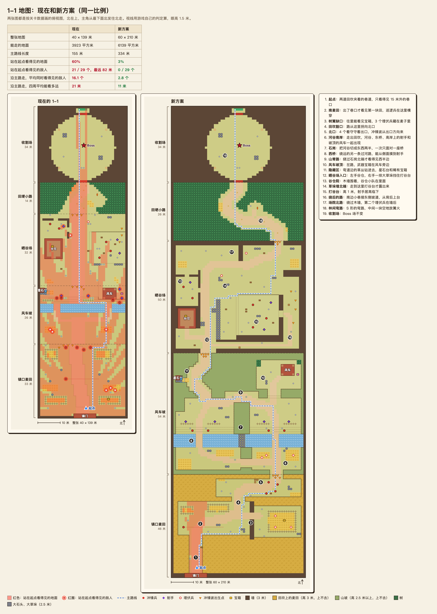
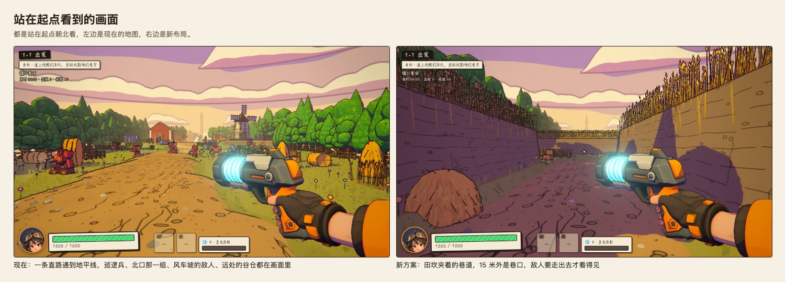
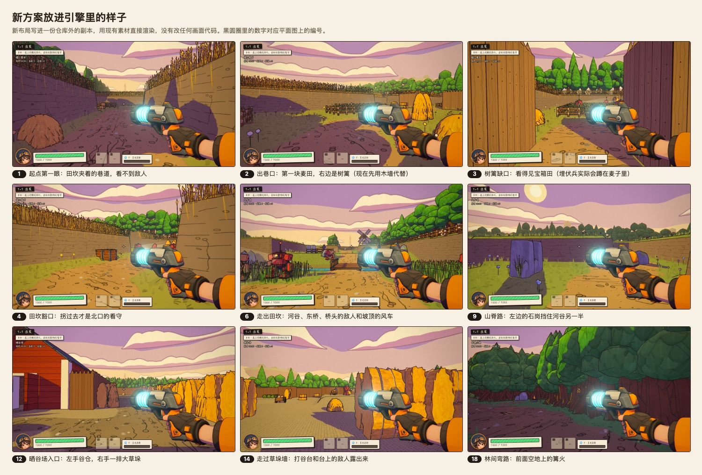

# 1-1 地图重做：为什么一览无余，准备改成什么样

- 状态：2026-11-11 建议稿，等用户看过再定。游戏代码和关卡数据都没动
- 相关：[关卡 1-1 出发](1-1.md)（现在的布局）、[渲染](../../tech/rendering.md)「剔除和远景」「预算」、[路线图](../../plan/roadmap.md)
- 图和数据：[`1-1-layout/`](1-1-layout/)。`compare.png` 平面对比图，`start.jpg` 起点画面对比，`engine.jpg` 新布局在引擎里的截图，`plan.txt` 新布局的字符画，`plan.json` 能直接喂给 `buildLevel` 的完整关卡数据

用户试玩后说：一进游戏地图就一览无余，前面有多少敌人都看得见；要多些墙、路和转弯，地图做大一些。这份先说现在为什么这样，再给新布局。先只做 1-1。

## 现在的问题

用游戏自己的视线判定算（眼高 1.5 米，算地形高度和所有挡子弹的东西）：

| | 现在 |
|---|---|
| 站在起点看得见的地面 | 全关能走的地面的 60%。镇口麦田 87%、风车坡 85%、晒谷场 46% |
| 站在起点看得见的敌人 | 29 个里的 21 个，最远的在 82 米外的晒谷场 |
| 沿主路走，平均同时看得见的敌人 | 16.1 个，最多 22 个 |

原因有三条：

1. 整关是一条 40 米宽、139 米长的直筒，土路从起点笔直通到 Boss 门口
2. 场地里的东西几乎都比眼睛矮：栅栏 0.9 米、麦子 1 米、石头 1.2 米、板车 1.4 米。挡得住视线的只有零星的 2.5 米大石头、大草垛和一座谷仓
3. 区域之间整排敞开，没有分隔；越往北地势越高（0 → 2 → 3 米），后面的区域像看台一样摆在眼前

上一版（2026-11-02）用墙和草垛把敌群隔开，解决的是「一叫全醒」，没管看不看得见。

## 设计原则

1. 一次只给看一个场面。每个战斗空间 20~30 米见方，四周用高过眼睛的东西围住，走进去才看见里面
2. 路要拐弯。直线不超过 15~20 米；河谷、打谷台这种故意给看的场面除外
3. 远处给目标，不给细节。风车和镇上的尖塔越过田坎看得见，敌人和地面看不见
4. 内容不动：5 个区域的顺序和作用、29 个敌人和 19 个冲锋波的编组、4 个宝箱、线索、隐藏区、Boss 场，都照现在的
5. 只用现有规则：区域还是从南到北叠起来的横带，格子符号、高度表、关卡校验都不用改

## 用什么挡视线

| 东西 | 高度 | 用在哪 | 引擎里现在的样子 |
|---|---|---|---|
| 田坎：垫高的麦田 | 3 米，上不去 | 镇口麦田各块田之间。本来就是麦田，路从田坎中间穿过去 | 直接能用：土层纹理的立面，顶上长着麦子（见下图 1、4） |
| 山坡和石岗：垫高的草地 | 4.5 米，上不去 | 风车坡：河谷两侧、河谷中间、风车周围 | 直接能用：立面加草顶（下图 6、9） |
| 墙（`#`） | 3 米 | 麦田里的树篱、晒谷场的院墙 | 现在所有的墙都是尖头木栅墙；树篱的样子要新做（下图 2、3 先用木墙代替） |
| 大草垛、大石头（`O`） | 2.5 米 | 晒谷场挡住打谷台的草垛墙，路上的弯 | 已有 |
| 建筑 | 4 米以上 | 镇门、谷仓、风车 | 已有 |
| 树（`T`） | 5 米 | 田埂小路两侧 | 已有，但铺满太贵，见「检验」 |

## 新布局

60 × 210 米（现在 40 × 139 米），能走的地面 6139 平方米（现在 3923），主路线 334 米（现在 155 米）。平面图上黑圆圈里的编号对应下面的说明。

这九张是把新布局写进一份仓库外的副本、用现有素材直接渲染的，没有改任何画面代码。

### 区 1 镇口麦田（46 行）

教学内容不变：移动、射击、开宝箱、躲冲锋。

- ① 起点在镇门外一条 6 米宽的巷道里，两边是 3 米高的田坎，只看得见 15 米外的巷口。巡逻兵在巷口外横穿，从起点能看到它走过去又被挡住
- ② 南麦田（31 × 15 米）：出了巷口才看见。里面两块围栏麦田是矮的，当掩体。土路在这里往东北拐
- ③ 东边一道树篱，中间留 3 米的缺口，从缺口看得见宝箱。宝箱田是个只有一个口的小院，3 个埋伏兵藏在麦子里
- ④ 北边田坎上一个 6 米宽的豁口，路从这里穿过去
- ⑤ 北口：4 个看守守着通往风车坡的出口。从豁口出来离最近的看守 13 米，它们的视野是 11.2 米，所以是你先看见它们。冲锋波从出口方向来

### 区 2 风车坡（54 行）

- ⑥ 从田坎中间的口子走出来，河谷一下子展开：正前方 10 米是东桥，桥头 2 个冲锋兵，20 多米外的高岸上 2 个射手，坡顶的风车在更后面。草丛里 3 个埋伏兵
- ⑦ 河谷中间一道石岗，把南岸、河面、北岸都切成东西两半。一次只面对一座桥、一组射手，不用同时应付 4 个
- ⑧ 西桥是绕远的路：沿南岸的小路往西 30 多米。从西桥上岸可以从侧面摸到东边的射手，反过来也一样
- ⑨ 过桥上坡是山脊路，往西走要绕过石岗的北端，绕过去才看得见西半边
- ⑩ 山脊路中段有一条岔路上风车坡顶，武器宝箱在风车旁边
- ⑪ 出口前的路拐两个弯。隐藏区（星石台和稀有宝箱）在弯道外侧，还是只能钻草进去

### 区 3 晒谷场（50 行）

- ⑫ 入口：左手是谷仓，门朝南，宝箱在里面；右手是一排 18 米长的大草垛，把东边的打谷台整个挡住。路上两堆草垛，要绕着走
- ⑬ 谷仓院在谷仓北边，木墙围着，北墙和东墙各一个口，谷仓小队在里面游荡
- ⑭ 走过草垛墙的北端，打谷台才露出来：18 × 18 米，高 1 米，射手在台上
- ⑮ 正面：从西边的缓坡上台，一路在射手的枪口下
- ⑯ 绕后：入口东边一条小巷贴着南墙往东，接到打谷台东边的夹道，从东侧的坡道上台，出现在射手背后。第二波冲锋波也从这条夹道来
- ⑰ 场院北边的路中间立一截木墙，路从墙南边绕过去，第二个埋伏兵在墙后

### 区 4 田埂小路（26 行）和区 5 收割场（34 行）

- ⑱ 林间小路走成 S 形，每段直路不超过 10 米。中间一块空地放篝火
- ⑲ 收割场原样搬过来，只是居中

## 检验

都是在临时文件里做的，没有改仓库里的代码和数据。

**关卡校验**：`validateLevel` 和第一人称四条规则（开局、叫醒、隐藏区、Boss 场）全过，叫醒最多连带 5 个。所有田坎和山坡都上不去（用 `climbableFrom` 查过，包括踩着石头、板车跳）。

**视线**：

| | 现在 | 新布局 |
|---|---|---|
| 站在起点看得见的地面 | 60% | 3%（只有巷道和巷口外的一条） |
| 站在起点看得见的敌人 | 21 / 29 | 0 / 29 |
| 沿主路走，平均同时看得见的敌人 | 16.1 个 | 2.8 个 |
| 沿主路走，同时看得见的敌人最多 | 22 个 | 11 个（走出田坎看河谷那一下，算上了身后北口的 4 个） |
| 沿主路走，四周平均能看多远 | 21 米 | 11 米 |

**自动驾驶**（各 10 个种子，普通难度）：

| | 现在 | 新布局 |
|---|---|---|
| 完美 | 10 / 10，75 秒，挨打 0.2 次 | 10 / 10，95 秒，挨打 0.2 次 |
| 普通玩家 | 10 / 10，92 秒，挨打 3.3 次 | 10 / 10，110 秒，挨打 2.6 次 |
| 新手 | 9 / 10，129 秒，挨打 10.4 次 | 10 / 10，144 秒，挨打 7.2 次 |

走得通、打得完。用时多 12%~27%，多出来的是走路；普通玩家和新手挨打少了，因为敌人一组一组出现，不再隔着半张地图一起围过来。自动驾驶不看风景也不犹豫，真人的用时会比这长，三星时间到时候按试玩重新定。

**三角形数**（预算 200 万）：

| 机位 | 现在 | 新布局，没做任何优化 |
|---|---|---|
| 起点 | 133 万 | 159 万 |
| 河谷南岸 | 133 万 | 174 万 |
| 晒谷场入口 | 216 万 | 167 万 |
| 打谷台 | — | 435 万 |
| 田埂小路 | 189 万 | 407 万 |

后两个超了一倍，原因只有一个：新的田埂小路把整片林子都摆成了树模型，1152 棵（现在 327 棵），相邻的晒谷场也会画到它。前三个机位都在预算内：田坎和山坡只多出立面，面数加得不多。

## 实现时要做的

等方向定了再做，这里先列出来：

1. 关卡数据：`level-1-1.ts` 换成 `plan.json` 的内容
2. 树林的画法：只在路两边两排放树模型，林子深处用地图两侧已有的树墙做法，把田埂小路压回 200 万以内。这一条不做不能上
3. 墙的样式：麦田里的墙画成树篱。1-2 的草捆墙也要「按区域指定墙的样式」，一起做
4. 田坎顶上的麦子只种靠边的两格，中间从下面看不见，不用种
5. 跟着改的：写死 1-1 坐标的单元测试、截图巡检的机位、e2e 冒烟里「开枪、进谷仓、打 Boss」的走位、自动驾驶的校准门槛、三星时间（现在 5 分钟）
6. 可选：墙和田坎把地图切成了互相看不见的房间，可以按房间做可见性裁剪，比现在按区域裁剪更省
7. 画图和检验用的脚本现在在会话的临时目录里，没进仓库。其余四关重做时都要用，定了方向后整理成一个命令

## 要你定的

1. 方向：「田坎加弯路，一次只看一个场面」行不行
2. 大小：60 × 210 米，主路线长了一倍多。觉得还不够大，或者走路太多，都可以调
3. 起点：一出门是 15 米长的巷道，两边是 3 米的田坎。如果觉得太闷，可以缩短到 8 米，或者把一侧换成齐胸的矮墙，让远处的风车露出来
4. 河谷：现在用石岗切成东西两半。想要一整片开阔的河谷也可以，那样一次要面对 4 个射手
