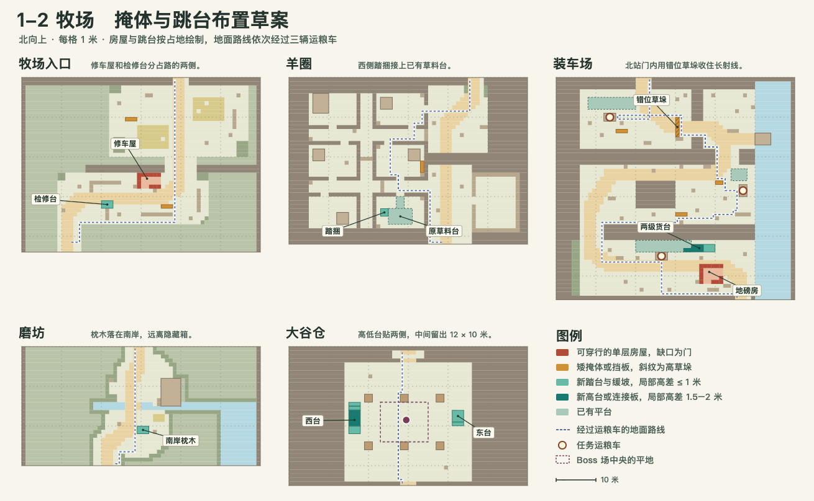
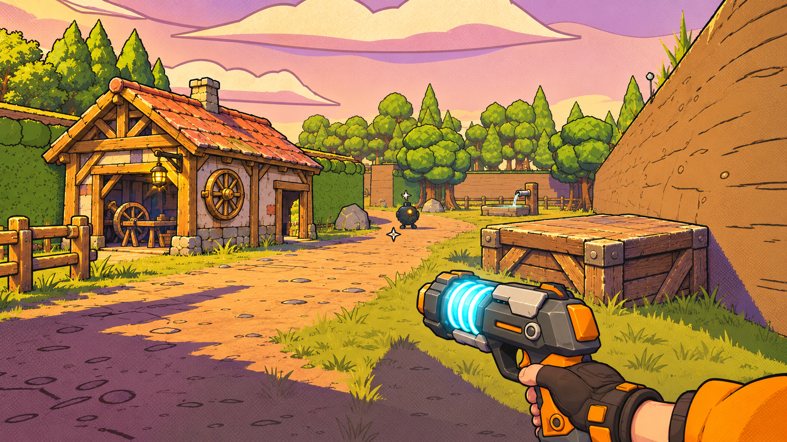
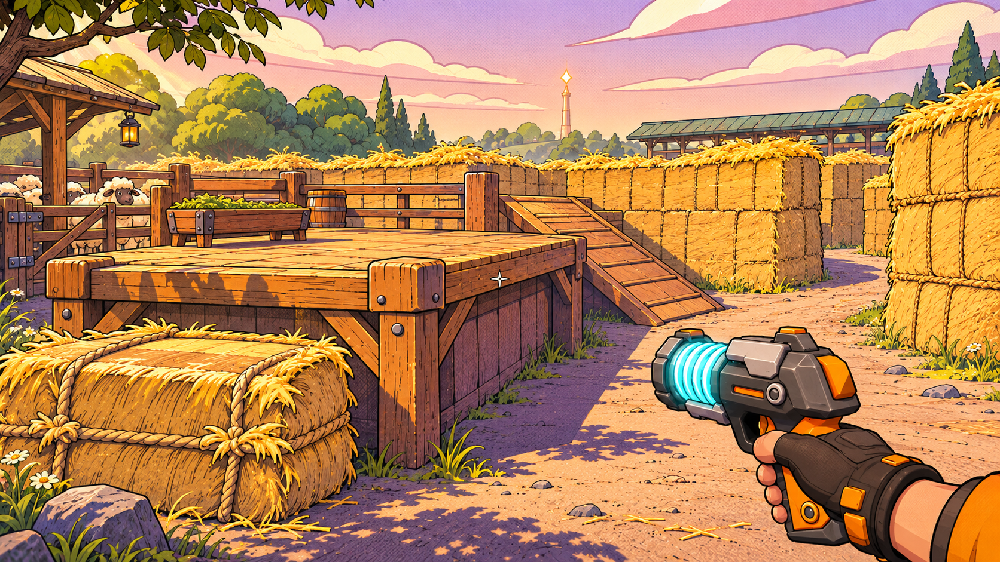
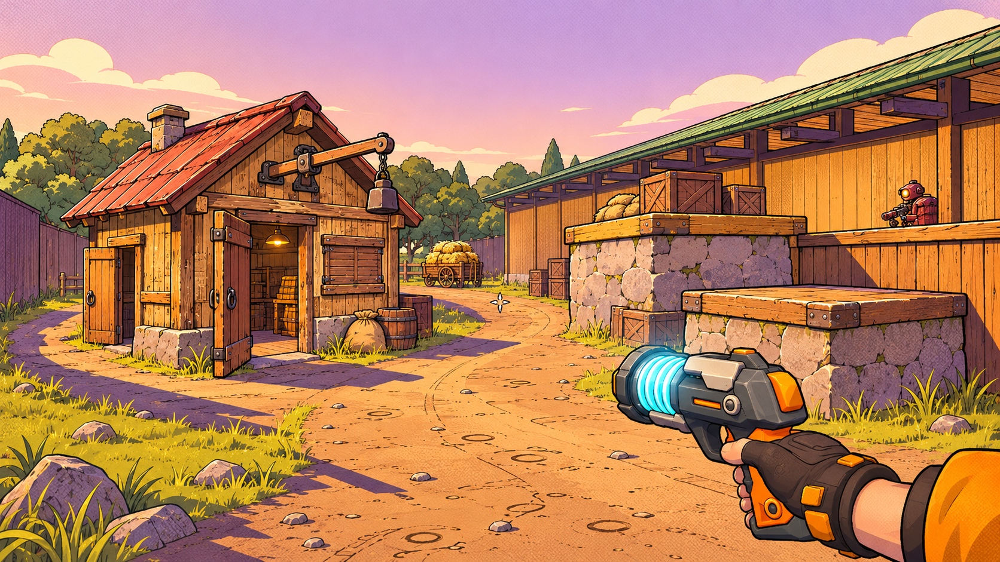
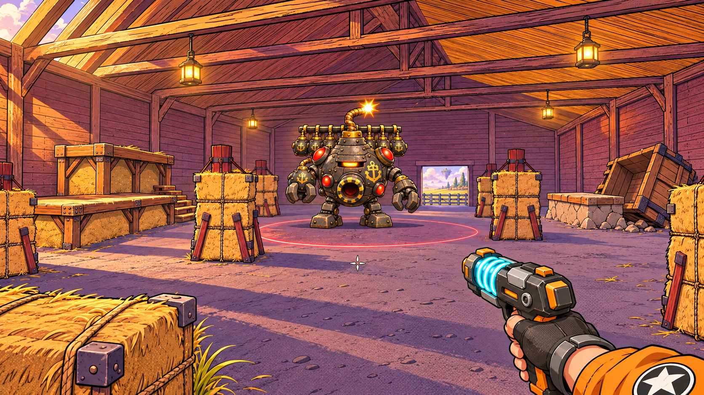

# 1-2 牧场的掩体、房屋与跳台

2026-11-19 · 已落地并通过自动验收，待真人试玩。基于 [1-2 关卡布局](1-2.md)和改造前的实机巡检绘制。

五区新增两栋能穿行的小屋、六组半身掩体、一列高草垛和六段可选跳跃路线。地面路线全程可走。入口教玩家用一次跳跃换视角，羊圈让玩家连续跳两级，装车场用房间和高台提供两种接近同一辆车的办法，大谷仓把高低差放在战场两侧。

改造前，起点已经只看得到 143 格地面。空旷感更明显的地方是出巷后的牧场、装车场南站和谷仓。下牧场的低栅栏能看穿，南站有一整面棚墙却少有可以穿过去的地方，谷仓的六根柱子提供躲避位置，换到另一根柱子时高度和打 Boss 的角度很接近。羊圈已有三米墙和六个院子，适合给已有平台多开一个入口。磨坊承担歇脚和对话，只做一处轻量变化。

## 俯视布置

格子每边 1 米。下文坐标使用各区域自己的 `(列, 行)`，从左上角的 `(0, 0)` 起算，矩形含两端。高度都相对附近主路地面。俯视图给出碰撞占地，四张第一人称概念图用于评审轮廓、落脚面和走法。

## 下牧场 · 修车屋与第一跳

从出生巷口走出来，玩家仍能先看到土路上的第一只自爆兵。左前方一栋挂着车轮的**修车屋**贴着树篱。南门朝土路，东门通向坡口。自爆兵逼近时，玩家可以穿屋换边，也可以走右侧，用检修台遮住低处、跳上台面观察去上牧场的路。

修车屋占 `(29,24)–(34,27)`，约 6 × 4 米。两扇门各宽 2 米，工作台和备件靠墙。检修台占 `(20,31)–(22,32)`，高 1 米，木板顶面完整。再往前的饮水槽位于 `(35,32)–(37,32)`，上牧场草边的短捆位于 `(26,10)–(28,10)`，两者按 1.2 米半身掩体验证。

## 羊圈 · 从踏捆上草料台

东南小院的两米草料台已有北坡。在西侧加一块 **2 × 2 米、高 1 米的固定踏捆**，位于 `(23,33)–(24,34)`。玩家从院子地面跳上踏捆，再跳到原来的木平台，可以看见下一条通道的敌人。受压时可从北坡下来，回到同一组院子。需要稳步推进时，原来的地面绕路仍通向北通道。

中东院的食槽贴东墙摆在 `(33,21)–(33,23)`，给拐角留出侧移空间。主通道、四个羊圈的门和羊去东侧草场的路都留空。可站的踏捆用两道绳子压平，三米分隔墙的顶部留松散草梗，让玩家在平视时读出区别。

## 装车场 · 穿磅房或走装车台

南站进门后，**地磅房**和低货墩相对的一段留三米宽的地面通道，在第 44～46 行穿过，西端原有的石头提示转弯。地磅房约 6 × 5 米，占 `(36,47)–(41,51)`。东侧和南侧各开两格门，两个开口错位。走屋内可以借实墙挡住射手，从侧门接近第一辆运粮车。走屋外可以从低货墩跳上秤货台，换一个越过近处掩体的射角。

低货墩占 `(37,42)–(39,43)`，高 1 米。秤货台占 `(34,42)–(36,43)`，高 2 米。西端两格连接板 `(32,43)–(33,43)` 以 1.5 米接回原装车台。台面靠边摆货，给落脚和转身留出至少 2 × 2 米。台下填实，旁边的磅房保持单层，适配当前[格子加高度的世界模型](../../decisions/0002-2.5d-sim.md)。

中站绕后路在 `(30,34)–(32,34)` 和 `(40,26)–(41,26)` 各给一小组低掩体，北站车侧在 `(15,13)–(17,13)` 放一组短垛。**北站门洞往里三米**，在 `(30,10)–(30,14)` 立一列高 2.5 米的草垛。这样从码头过来会先看到转角，再看到北站车尾。临时测量中，南站新高台的六格都能看到本车，能看到第二、三辆车的格数均为零。

## 磨坊 · 南岸留一个观景点

在木桥南岸 `(29,20)–(31,21)` 放一组高 1 米的捆扎枕木。玩家可以跳上去看水轮和桥头，再落回土路。老汤与耕地机残骸仍在北岸。枕木远离挡住暗门的木箱，桥头和对话触发区保留完整视野。

## 大谷仓 · 两侧换位，中间躲招

西墙两排可倒草垛柱之间增加**实心分粮台**。南端 `(15,20)–(17,21)` 高 1 米，再往北的 `(15,17)–(17,19)` 高 2 米。台侧可以连续两跳上去，北端三排沿 `16、15、14` 行依次降到 `1.5、1、0.5` 米。小兵也能从这端接近。东墙 `(41,16)–(43,18)` 配一个高 1 米的旧料斗基座，第 19 行的半米踏步接回地面。东侧用于短暂换位，和西台形成不同打法。

中央 `(23,14)–(34,23)` 留出 **12 × 10 米平地**，方便看见炸弹落点和 Boss 炮口。六根会塌的柱子仍负责提供整身掩护。新增台面靠墙，到半血召唤时四角仍能出兵。草模中，沿柱间与南北空地选取的一圈路线，按每 0.25 米采样，中心线距静态阻挡最近 2.5 米。

## 草模验证

校验使用临时关卡副本和项目现有的移动、视线、寻路及自动驾驶逻辑。房屋用开门墙格表示，半身掩体用 1.2 米障碍格表示，可跳台面按实际高度铺格。游戏现有基础跳高为 1.3 米，普通行走可跨 0.5 米台阶。六段路线都已用 60 Hz 的玩家移动逻辑实测落地，羊圈、装车场和谷仓西侧的连续两跳均无需空中冲刺。两栋房屋的四个门洞及室内均可从起点到达。 [高度规则](../../../src/data/heights.ts) · [移动逻辑](../../../src/sim/player.ts)

| 静态测量 | 改造前 | 草模 |
|---|---:|---:|
| 可达地面 | 5,687 平方米 | 5,639 平方米 |
| 起点可见地面 / 初始敌人 | 143 格 / 0 个 | 143 格 / 0 个 |
| 起点到出口的地面最短路 | 349 米 | 349 米 |
| 沿最短路同时可见的敌人峰值 | 6 | 4 |
| 惊动一个敌人最多连带 | 3 | 3 |

表中最短路按门开启计算。俯视图中的蓝线另外指定经过三辆车。入口饮水槽也单独做过射线检查，同高度地面上，从 1.45 米高处瞄槽后玩家胸口的直线被挡住，玩家从 1.5 米眼高可以越过槽沿看到对方。

普通难度，种子 1～30，装备拳脚 1 级、震荡雷 2 级、霰弹枪和草帽。每种布局跑 90 局，通关用时只统计通关局。机器人主要走地面路线，跳台另以定点起跳检查。

| 自动驾驶 | 改造前通关 | 草模通关 | 平均通关用时，改造前 → 草模 | 局均受击，改造前 → 草模 |
|---|---:|---:|---:|---:|
| 完美 | 30/30 | 30/30 | 106.1 → 109.9 秒 | 1.3 → 0.6 |
| 普通玩家 | 30/30 | 30/30 | 156.9 → 142.6 秒 | 3.2 → 4.2 |
| 新手 | 28/30 | 29/30 | 272.8 → 237.7 秒 | 7.1 → 7.7 |

## 实现与验收

两栋房屋用地标占格和程序模型搭建，门口可见宽度与碰撞一致。修车屋挂车轮，地磅房东门上方装秤杆。台面按高度图立边，南站木面落在石基上，原装车台一并铺齐台沿以接上连接板。羊圈的回程坡用连续的木面连接原有高度格。矮草捆和麻袋沿用着火后腾出格子的规则，饮水槽、食槽、结构枕木与高草垛屏保持可用。

实装的地图校验通过，静态测量与草模一致。Chrome 用固定步长走完六段跳跃路线和两屋穿行。南站新高台的六格都能直接看到南站车，另外两辆车隔在院墙后。谷仓四个召唤点和中央 12 × 10 米地面均可用。爆破头目瞄西分粮台时，实机预警圈贴在该层台面上。炸弹提前碰到更高的地面时按实际接触高度结算爆炸。

沿用草模的普通难度、装备与种子 1～30，实装三档复跑如下。新手档两次阵亡都发生在装车场，分别来自火药桶和射手。

| 自动驾驶 | 实装通关 | 通过局平均用时 | 局均受击 |
|---|---:|---:|---:|
| 完美 | 30/30 | 109.8 秒 | 0.6 |
| 普通玩家 | 30/30 | 143.8 秒 | 4.2 |
| 新手 | 28/30 | 241.1 秒 | 7.5 |

Chrome 对照改前后 14 个原机位，增拍了 11 个入口、室内和跳台机位。另捕获了谷仓西台的实战预警。六个原性能机位仍以 1600 × 900 各测两秒，三角形峰值从 165.6 万升到 166.4 万。装车场机位平均绘制调用从 1,756 次升到 1,860 次，仍高于项目的 500 次预算。原有对话、结算和切到 1-3 的端到端回归通过。 [机位表](../../../scripts/shots/spots.json) · [本地验证](../../tech/local-development.md)

## 真人试玩重点

1. 南站入口和中站绕后路的射手压力，尤其是被高处射手盯上后能否借磅房或台阶换位。新手自动驾驶的两次阵亡都落在这一区。
2. 大谷仓半血召唤和柱子坍塌后，西分粮台的侧面下落、北端回落以及中央绕圈是否仍然容易判断。

四张效果图由本次 Codex 会话的内置 ImageGen 依据实机截图生成。完整提示词和图像存放在[概念图目录](../../../art/concept/pasture-traversal/)。
