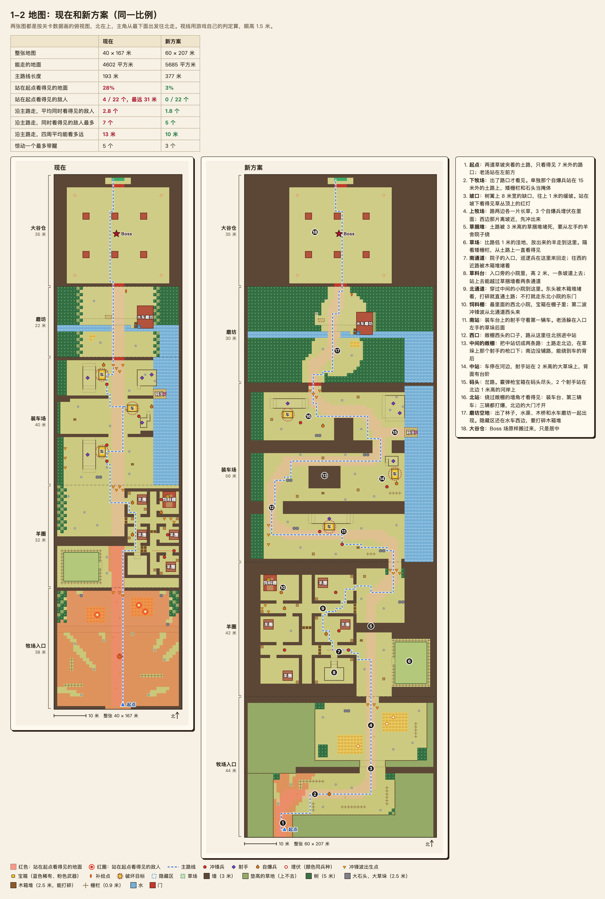

# 1-2 地图重做：新布局（建议稿）

- 状态：建议稿（2026-11-11），等用户看。关卡数据和游戏代码都没改
- 相关：[关卡 1-2 牧场](1-2.md)（现在的布局和各区域的内容）、[1-1 地图重做](1-1-layout.md)（同一套原则，已落地）、[地图工具](../../tech/map-tools.md)（图和数字是怎么来的）
- 图：[`1-2-layout/compare.png`](1-2-layout/compare.png)。草稿在 `scripts/map/sketches/1-2.mjs`，`pnpm map compare 1-2 scripts/map/sketches/1-2.mjs` 能重新画出来

1-1 换成新地图以后，用户让照着再设计 1-2，先只看地图。

## 现在的问题

1-2 在 2026-11-04 为第一人称重摆过一次，羊圈已经用 3 米的草捆墙隔成小院，所以没有 1-1 当时那么严重（1-1 站在起点能看见 60% 的地面、21 个敌人）。剩下的问题是：

| | 现在 |
|---|---|
| 站在起点看得见的地面 | 全关的 28%；牧场入口这一个区域是 94% |
| 站在起点看得见的敌人 | 4 个，就是牧场入口的全部：路上那个，加草丛里埋伏的 3 个（实际只露出头顶的红灯） |
| 土路 | 从起点到大谷仓门口是一条直线，全程在同一列上，只在羊圈被草捆堆截断一次 |
| 装车场 | 三站沿着直路排开，走到南站和中站之间的口子能同时看见 7 个敌人 |
| 整张地图 | 40 × 167 米的直筒 |

## 原则

和 1-1 一样：

1. 一次只给看一个场面，走进去才看见里面
2. 路要拐弯，直路不超过 15~20 米；故意给看的场面除外（上牧场的坡、磨坊空地）
3. 内容不动：5 个区域的顺序和作用、22 个敌人和 5 个冲锋波的编组、宝箱、三辆运粮车、4 个羊圈、草场、草料台、饲料棚、3 处木箱堆、码头、水车磨坊和隐藏区、Boss 场
4. 只用现有规则：区域还是从南到北叠起来的横带，格子符号、高度表、关卡校验都不用改

## 新布局

60 × 207 米（现在 40 × 167），能走的地面 5685 平方米（现在 4602），主路线 377 米（现在 193 米，两边都按经过三辆车算）。图上黑圆圈的编号对应下面的说明。

| 区域 | 现在 | 新方案 | 用什么挡视线 |
|---|---|---|---|
| 牧场入口 | 38 行 | 44 行 | 3~4 米高的草坡、树篱（1-1 麦田里那种） |
| 羊圈 | 32 行 | 42 行 | 草捆墙，和现在一样；院子放大 |
| 装车场 | 40 行 | 56 行 | 敞棚（3 米的墙），把三站隔成三个院子 |
| 磨坊 | 22 行 | 30 行 | 树林 |
| 大谷仓 | 35 行 | 35 行 | 不变 |

### 区 1 牧场入口

教学内容不变：先单独见一个自爆兵，再躲草丛里冲出来的 3 个。

- ① 起点在两道草坡之间的土路上，只看得见 7 米外的路口。老汤站在左前方
- ② 出了路口是下牧场（38 × 13 米），土路在这里往东拐。单独那个自爆兵站在 15 米外的路上，它的视野 10.4 米，这时还没发现主角。矮栅栏和石头是给主角用的掩体，都不挡视线
- ③ 北边一道树篱，中间 8 米宽的缺口，往上 1 米的缓坡。站在坡下看得见上面两片长草和草顶上的红灯
- ④ 上牧场（35 × 18 米）是故意敞开的场面：路两边各一片长草，西边那片埋 1 个、离坡近，东边那片埋 2 个。路的尽头是树篱上的门，门后面看得见羊圈的土路和堵路的草捆堆

和现在不一样的地方：现在一进关就看得见那个自爆兵，新方案要走出 7 米的路口才看见。距离、它先不发现主角这两点没变。

### 区 2 羊圈

院子的结构不变（两列三排 6 个小院、两条东西向通道、一条南北向通道、3 处木箱堆），整体左右翻了个面，放大了。

- ⑤ 进门往北 20 米，土路被草捆堆堵死。院子在左手（西边）
- ⑥ 草场搬到右手，紧挨着土路：比路低 1 米，四周矮栅栏。从进门到绕进院子，一路都看得见它；区里打完，羊从院子里出来走到这里
- ⑦ 南通道是院子的入口，巡逻兵在通道东段来回走。往西被木箱堆堵着
- ⑧ 草料台在入口旁边的东南小院，高 2 米，北边一条坡道。台子离院墙隔了一格，不能从台上跳到墙上
- ⑨ 正路：南通道 → 中间靠东的小院 → 北通道 → 东北小院 → 东门回到土路。北通道的东头被木箱堆堵着，打碎就直通土路
- ⑩ 饲料棚和宝箱在最远的西北小院。南组（冲锋兵 2、自爆兵 1，加巡逻兵）在南通道和中间一排；北组（冲锋兵 1、自爆兵 2）在北通道和北边一排，两组的门错开，互相看不见
- 草捆堆北边的土路往东北拐，从东边的门出去

### 区 3 装车场

现在是一条直路串起三站。新方案把三站放进三个院子，土路走成一个 S：往西、往东、再往西。

- ⑪ 南站：从东南角进来，装车台在院子北边靠着敞棚，射手在台上，车停在台子南边，车边 2 个冲锋兵。老汤躲在入口左手的草垛后面。第一波冲锋波从西边的树林边来
- ⑫ 院子西头，敞棚上一个 6 米宽的口子，路从这里往北拐进中站
- ⑬ 中站院子中间立一座敞棚（10 × 7 米），把院子分成两条路。土路走北边，一路在草垛上那个射手的枪口下；南边没铺路，贴着敞棚走能绕到车的背后
- ⑭ 中站的车停在东头靠河，射手站在旁边 2 米高的大草垛上（背面有台阶），车边冲锋兵 1、自爆兵 1
- ⑮ 从中站东北角的口子往北出来，右手是码头岔路：霰弹枪宝箱在码头尽头，2 个射手站在北边 1 米高的河岸上
- ⑯ 北站被一段敞棚的墙挡着，绕过墙角才看得见：装车台和射手在西北角，第三辆车在台子南边。三辆车都打爆，北边的大门才开。第二波冲锋波从门前来

三站之间互不连带，惊动一个最多带醒 3 个（现在是北站加码头一起 5 个）。

### 区 4 磨坊、区 5 大谷仓

- ⑰ 从大门出来是林间小路，往东北拐一个弯，树林散开，水渠、木桥和水车磨坊一起出现。冲锋兵残骸和老汤在桥北，隐藏区还在水车西边、木箱堆后面，篝火在谷仓门前。水渠往东流进装车场那条河
- ⑱ 大谷仓原样搬过来，只是居中

## 检验

**关卡校验**：`validateLevel` 全过（第一人称的开局、叫醒、隐藏区、Boss 场四条都在里面）。草坡、墙、树都上不去，用 `climbableFrom` 查过。

**视线**（敌人都按站在原位算）：

| | 现在 | 新方案 |
|---|---|---|
| 站在起点看得见的地面 | 28% | 3% |
| 站在起点看得见的敌人 | 4 / 22 | 0 / 22 |
| 沿主路走，平均同时看得见的敌人 | 2.8 个 | 1.8 个 |
| 沿主路走，同时看得见的敌人最多 | 7 个（装车场南站和中站之间） | 5 个（装车场中站） |
| 沿主路走，四周平均能看多远 | 13 米 | 10 米 |
| 惊动一个最多带醒 | 5 个 | 3 个 |

新方案的「最多 5 个」里有 2 个是隔着敞棚露出头顶的：站在 1.5 米装车台和 2 米草垛上的射手，头比 3 米的墙高。现在的地图也一样。按游玩顺序，看见它们的时候前一站已经打完了。

**自动驾驶**（各 10 个种子，普通难度，生命加 1 点，和 1-2 的校准用例一样）：

| | 现在 | 新方案 |
|---|---|---|
| 完美 | 10 / 10，81 秒，挨打 0.8 次 | 10 / 10，98 秒，挨打 0.5 次 |
| 普通玩家 | 9 / 10，151 秒，挨打 3.9 次 | 10 / 10，153 秒，挨打 1.9 次 |
| 新手 | 10 / 10，258 秒，挨打 9.2 次 | 8 / 10，260 秒，挨打 9.9 次 |

走得通、打得完。普通玩家档现在死的那一局，是站在羊圈北口和装车场装车台上的射手隔着半张图对射；新方案里两个区域之间隔着墙，这种情况没有了。新手档死的两局都在装车场，一局被自爆兵炸死，一局被射手打死。

## 没做的和要注意的

- 没有引擎里的截图。1-2 的场景还没做（羊圈的草捆墙、装车场的敞棚现在都画成木栅墙），截出来不代表最后的样子；工具也还不能把草稿放进引擎
- 性能没量。墙和台地比现在多，磨坊的树林从 40 × 22 变成 60 × 30（深处的树会按 1-1 那次做的规则减掉）。落地时用 `pnpm perf spots --levels 1-2` 量，超了再处理
- 站在台子上的射手会从墙头露出头顶，见上文
- 三星的用时（9 分钟）和受击（15 次）先不动，落地后按自动驾驶和试玩重新定

## 想请你定的

1. 整体走向行不行：路在装车场走成 S、羊圈整体翻到路的西边、草场挪到进门右手
2. 起点看不见单独那个自爆兵，走出路口才看见。想保留「一进关就看见它」的话，把起点那段路拉直就行
3. 装车场中站分成「土路」和「绕后」两条路，是这一版新加的走法，其余站位都照原设计

## 定了以后要做的

1. `pnpm map emit` 把草稿写成 `level-1-2.ts`，草稿删掉
2. 重写写死坐标的测试：`level.test.ts` 的 1-2 部分、`calibration-1-2.test.ts`、用到 1-2 的羊、提示、关卡信息的用例
3. 冲锋兵的喊话触发点、截图巡检的机位、自动驾驶在 1-2 的表现
4. 量性能
5. 「场景」那一步照旧：草捆墙、敞棚、装车台、谷仓室内、老汤占位
