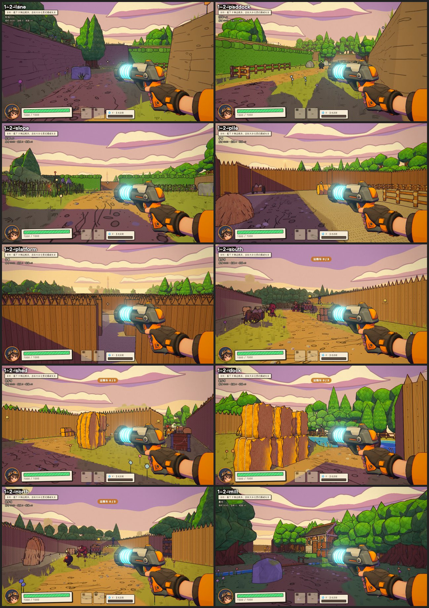

# 1-2 地图重做：为什么改，改成了什么样

- 状态：2026-11-11 出建议稿，用户定了方向，同日落地（见文末「落地」）。和建议稿不一样的地方也列在那里
- 相关：[关卡 1-2 牧场](1-2.md)（各区域的内容）、[1-1 地图重做](1-1-layout.md)（同一套原则）、[地图工具](../../tech/map-tools.md)（图和数字是怎么来的）
- 图：[`1-2-layout/`](1-2-layout/)。`compare.png` 改前改后的平面对比，`engine.jpg` 新地图在引擎里的截图。关卡数据在 `src/data/levels/level-1-2.ts`

1-1 换成新地图以后，用户让照着再设计 1-2。

## 改前的问题

1-2 在 2026-11-04 为第一人称重摆过一次，羊圈已经用 3 米的草捆墙隔成小院，所以没有 1-1 当时那么严重（1-1 站在起点能看见 60% 的地面、21 个敌人）。剩下的问题是：

| | 改前 |
|---|---|
| 站在起点看得见的地面 | 全关的 28%；牧场入口这一个区域是 94% |
| 站在起点看得见的敌人 | 4 个，就是牧场入口的全部：路上那个，加草丛里埋伏的 3 个（实际只露出头顶的红灯） |
| 土路 | 从起点到大谷仓门口是一条直线，全程在同一列上，只在羊圈被草捆堆截断一次 |
| 装车场 | 三站沿着直路排开，走到南站和中站之间的口子能同时看见 7 个敌人 |
| 整张地图 | 40 × 167 米的直筒 |

## 原则

和 1-1 一样：

1. 一次只给看一个场面，走进去才看见里面
2. 路要拐弯，直路不超过 15~20 米；故意给看的场面除外（上牧场的坡、磨坊空地）
3. 内容不动：5 个区域的顺序和作用、22 个敌人和 5 个冲锋波的编组、宝箱、三辆运粮车、4 个羊圈、草场、草料台、饲料棚、3 处木箱堆、码头、水车磨坊和隐藏区、Boss 场
4. 只用现有规则：区域还是从南到北叠起来的横带，格子符号、高度表、关卡校验都不用改

## 新布局

60 × 207 米（改前 40 × 167），能走的地面 5692 平方米（改前 4602），主路线 389 米（改前 193 米，两边都按经过三辆车算）。图上黑圆圈的编号对应下面的说明。

| 区域 | 改前 | 改后 | 用什么挡视线 |
|---|---|---|---|
| 牧场入口 | 38 行 | 44 行 | 3~4 米高的草坡、树篱（1-1 麦田里那种） |
| 羊圈 | 32 行 | 42 行 | 草捆墙，和改前一样；院子放大 |
| 装车场 | 40 行 | 56 行 | 敞棚（3 米的墙），把三站和码头隔成四个院子 |
| 磨坊 | 22 行 | 30 行 | 树林：路和空地两边一排树，后面是 4.5 米的土坡 |
| 大谷仓 | 35 行 | 35 行 | 不变 |

羊圈和装车场的墙现在都还是木栅墙，草捆墙和敞棚要到「场景」那一步才换。

### 区 1 牧场入口

教学内容不变：先单独见一个自爆兵，再躲草丛里冲出来的 3 个。

- ① 起点在两道草坡之间的土路上，只看得见 7 米外的路口。老汤站在左前方
- ② 出了路口是下牧场（38 × 13 米），土路在这里往东拐。单独那个自爆兵站在 15 米外的路上，它的视野 10.4 米，这时还没发现主角。矮栅栏和石头是给主角用的掩体，都不挡视线
- ③ 北边一道树篱，中间 8 米宽的缺口，往上 1 米的缓坡。站在坡下看得见上面两片长草和草顶上的红灯
- ④ 上牧场（35 × 18 米）是故意敞开的场面：路两边各一片长草，西边那片埋 1 个、离坡近，东边那片埋 2 个。路的尽头是树篱上的门，门后面看得见羊圈的土路和堵路的草捆堆

和改前不一样的地方：改前一进关就看得见那个自爆兵，现在要走出 7 米的路口才看见。距离、它先不发现主角这两点没变。

### 区 2 羊圈

院子的结构不变（两列三排 6 个小院、两条东西向通道、一条南北向通道、3 处木箱堆），整体左右翻了个面，放大了。

- ⑤ 进门往北 20 米，土路被草捆堆堵死。院子在左手（西边）
- ⑥ 草场搬到右手，紧挨着土路：比路低 1 米，四周矮栅栏。从进门到绕进院子，一路都看得见它；区里打完，羊从院子里出来走到这里
- ⑦ 南通道是院子的入口，巡逻兵在通道东段来回走。往西被木箱堆堵着
- ⑧ 草料台在入口旁边的东南小院，高 2 米，北边一条坡道。台子离院墙隔了一格，不能从台上跳到墙上
- ⑨ 正路：南通道 → 中间靠东的小院 → 北通道 → 东北小院 → 东门回到土路。北通道的东头被木箱堆堵着，打碎就直通土路
- ⑩ 饲料棚和宝箱在最远的西北小院。南组（冲锋兵 2、自爆兵 1，加巡逻兵）在南通道和中间一排；北组（冲锋兵 1、自爆兵 2）在北通道和北边一排，两组的门错开，互相看不见
- 草捆堆北边的土路往东北拐，从东边的门出去

### 区 3 装车场

改前是一条直路串起三站。现在三站各在一个院子里，土路走成一个 S：往西、往东、再往西。

- ⑪ 南站：从东南角进来，装车台在院子北边靠着敞棚，射手在台上，车停在台子南边，车边 2 个冲锋兵。老汤躲在入口左手的草垛后面。第一波冲锋波从西边的树林边来
- ⑫ 院子西头，敞棚上一个 6 米宽的口子，路从这里往北拐进中站
- ⑬ 中站院子中间立一座敞棚（10 × 7 米），把院子分成两条路。土路走北边，一路在草垛上那个射手的枪口下；南边没铺路，贴着敞棚走能绕到车的背后
- ⑭ 中站的车停在东头靠河，射手站在旁边 2 米高的大草垛上（背面有台阶），车边冲锋兵 1、自爆兵 1
- ⑮ 从中站东北角的口子往北出来是码头小院：2 个射手站在北边 1 米高的河岸上，出口旁一排大草垛当掩体，霰弹枪宝箱在码头尽头
- ⑯ 码头小院西边是一道敞棚墙，墙上一个 4 米宽的门洞。穿过去才是北站：装车台和射手在西北角，第三辆车在台子南边。三辆车都打爆，北边的大门才开。第二波冲锋波从门前来

四组之间互不连带，惊动一个最多带醒 3 个（改前是北站加码头一起 5 个）。

### 区 4 磨坊、区 5 大谷仓

- ⑰ 从大门出来是林间小路，往东北拐一个弯，树林散开，水渠、木桥和水车磨坊一起出现。冲锋兵残骸和老汤在桥北，隐藏区还在水车西边、木箱堆后面，篝火在谷仓门前。水渠从桥西边起头，往东流进装车场那条河
- ⑱ 大谷仓原样搬过来，只是居中

## 检验

**关卡校验**：`validateLevel` 全过（第一人称的开局、叫醒、隐藏区、Boss 场四条都在里面）。草坡、土坡、墙、树都上不去，写成了单元测试。

**视线**（敌人都按站在原位算）：

| | 改前 | 改后 |
|---|---|---|
| 站在起点看得见的地面 | 28% | 3% |
| 站在起点看得见的敌人 | 4 / 22 | 0 / 22 |
| 沿主路走，平均同时看得见的敌人 | 2.8 个 | 1.8 个 |
| 沿主路走，同时看得见的敌人最多 | 7 个（装车场南站和中站之间） | 7 个（码头小院，见下） |
| 沿主路走，四周平均能看多远 | 13 米 | 10 米 |
| 惊动一个最多带醒 | 5 个 | 3 个 |

改后的「最多 7 个」出现在码头小院里正对着门洞的两三步：院里的 2 个射手，从门洞看过去 15~27 米外北站的 3 个，再加回头从来时的口子里看得见的中站 2 个。北站那 3 个离得比它们的视野远，中站那 2 个按游玩顺序这时已经打掉了。除了这几步，沿路最多同时看见 5 个。

**自动驾驶**（普通难度，生命加 1 点，和 1-2 的校准用例一样）：

| | 改前，10 局 | 改后，10 局 | 改前，30 局 | 改后，30 局 |
|---|---|---|---|---|
| 完美 | 10，81 秒，挨打 0.8 次 | 10，98 秒，挨打 0.1 次 | — | 30，100 秒，挨打 0.1 次 |
| 普通玩家 | 9，151 秒，挨打 3.9 次 | 10，149 秒，挨打 2.6 次 | 29，169 秒，挨打 2.8 次 | 30，160 秒，挨打 3.1 次 |
| 新手 | 10，258 秒，挨打 9.2 次 | 9，269 秒，挨打 10.4 次 | 27，269 秒，挨打 8.6 次 | 23，310 秒，挨打 9.8 次 |

每格第一个数是通关的局数。10 局的波动大，所以另跑了 30 局：完美和普通玩家都全通；新手档从 27 局降到 23 局，死的 7 局里 5 局在装车场，其中 2 局是敌人还剩七八个就走上码头拿宝箱，被河岸上的射手打死。普通玩家档改前死的那一局，是站在羊圈北口和装车场装车台上的射手隔着半张图对射，现在两个区域之间隔着墙，这种情况没有了。

**性能**（`pnpm perf spots --levels 1-2`，同一台机器先量改前的副本再量改后；帧时间受机器负载影响，只看量级）：

| 位置 | draw call 前 → 后 | 三角形（万）前 → 后 | 帧时间 p50（ms）前 → 后 |
|---|---|---|---|
| 起点，看向北边 | 1508 → 1263 | 129.9 → 123.1 | 4.8 → 3.8 |
| 羊圈 | 1911 → 1671 | 176.3 → 159.4 | 5.5 → 4.4 |
| 装车场 | 1581 → 1578 | 160.0 → 170.8 | 5.5 → 4.6 |
| 装车场，回头看来路 | 1301 → 1370 | 130.5 → 146.9 | 4.7 → 3.9 |
| 磨坊 | 1059 → 1006 | 103.9 → 119.2 | 3.8 → 3.3 |
| 大谷仓 Boss 战 | 687 → 655 | 70.3 → 75.4 | 3.2 → 2.8 |

六个位置都在 200 万三角形的预算内。另外在 14 个截图机位和 6 个自己挑的角度各读了一次三角形数，最高 173 万（站在装车场的入口往北看）。

## 落地（2026-11-11）

| 事项 | 做成了什么 |
|---|---|
| 关卡数据 | `level-1-2.ts` 换成新布局，由草稿用 `pnpm map emit` 生成；草稿已删，以后直接改这份数据 |
| 测试 | `level.test.ts` 的 1-2 部分按新布局重写，另加「起点看不见任何敌人、看得见的地面不到 8%」「草坡、墙、树都上不去」「单独那个自爆兵走出路口才看得见，离路口 15 米」「三站加码头四组互不连带」「中站分土路和绕后两条路」；耕地机那句、Boss 炮口红线的用例换了坐标 |
| 喊话 | 「抱歉！干草也借用一下！」挂到南站车边的冲锋兵身上 |
| 机位 | 截图巡检加 14 个 1-2 的机位（`scripts/shots/spots.json`），性能加 6 个（`scripts/perf/spots.json`，默认还是只量 1-1，加 `--levels 1-2`） |
| 三星 | 9 分钟、受击 15 次，没动 |

和建议稿不一样的地方：

| 改了什么 | 为什么 |
|---|---|
| 磨坊的树林只在路、空地和水边留一排树，后面换成 4.5 米高的土坡；水渠从桥西边起头，不再横穿整片林子 | 照建议稿铺满树是 531 棵（改前 167 棵），从装车场入口往北看全在视野里，那个位置到了 231 万三角形。现在 142 棵，同一位置 171 万。站在路上看，一排树已经是一堵不透的树墙 |
| 装车场西边的树带只留南站那一段（冲锋波从那里来），中站、北站的西边是墙 | 同上 |
| 码头从北站院子里隔出来，单独成一个小院，穿过敞棚墙上的门洞才到北站；出口旁加一排大草垛 | 建议稿里北站 3 个、码头 2 个射手和第二波冲锋波的 6 个都在同一个院子，刚出口子就被河岸上的射手夹击。隔开以后普通玩家档 30 局从 29 局通关变成全通 |
| 北站那辆车掉了个头；羊圈里零散的木箱从 12 个减到 9 个 | 对上原设计的数量 |

没做的：

- 新手档比改前难了一截（30 局通关 27 → 23），多出来的死法主要是没清完河岸上的射手就上码头。自动驾驶打不着也不挪、不躲掩体，真人未必这样；留到「做的顺序」第 6 步校准时和试玩一起看
- 草捆墙、敞棚、装车台、谷仓室内、老汤占位，还是「场景」那一步的事

还要用户试玩看的：起点那段土路和 1-1 的巷道是同一种开场，会不会重复；装车场中站「绕后」那条路用不用得上；码头小院出口那排草垛够不够躲。
