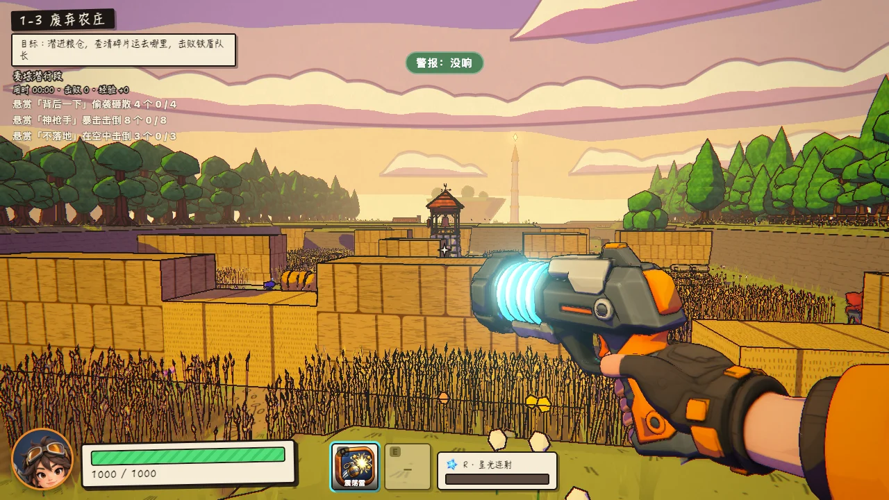
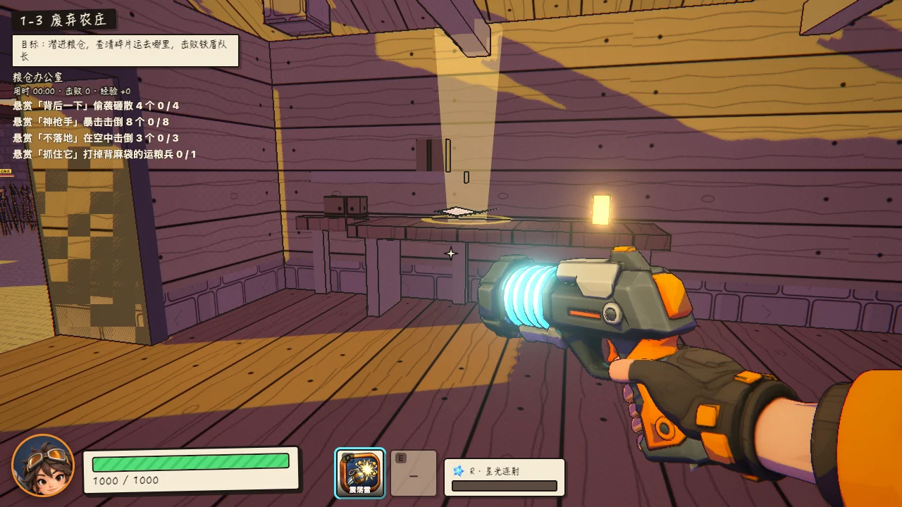
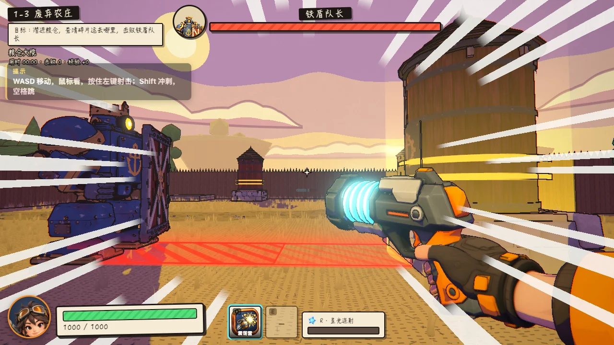
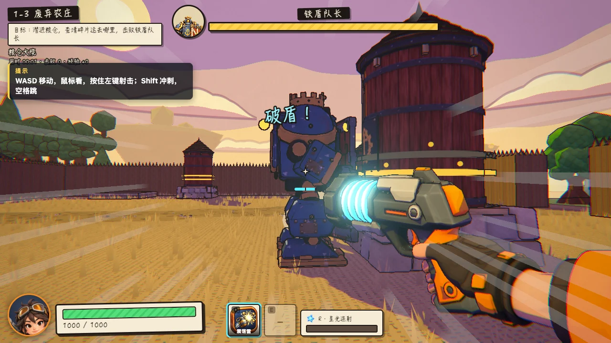

# 1-3 废弃农庄

凯追着运粮车进入农庄，在粮仓办公室找到盖着船锚印的运粮单。玩家可以从麦田安静穿过，也可以在暴露后截下跑钟者。钟声决定农舍院子要打几波敌人。关底的铁盾队长守着通往雾林的北门。

第一人称版于 2026-11-20 接通整关。正式版通关 1-2 后解锁，开发版可直接从整备界面选择「1-3 废弃农庄」。首通解锁弹射枪和「门板」徽章，结算页可进入 1-4「林间小道」。实现 MR 待确认。 [关卡数据](../../../src/data/levels/level-1-3.ts) · [剧情](../../../src/data/dialogue.ts) · [首通武器](../../../src/data/loot.ts) · [徽章](../../../src/data/badges.ts)

## 地图与路线

地图宽 60 米、长 204 米，南进北出，地图工具测得地面主路线 266 米。出生点只能看到 6,668 平方米可达地面中的 148 平方米（2.22%），15 名初始小兵全部在视线外。沿地面主路平均能看见 1.9 名敌人，最多 6 名，一次警觉最多带醒 5 名。 [俯视图，含路线、地形、敌人和宝箱](1-3/layout.png)

| 从南往北 | 整图行号 | 走法与遭遇 |
| --- | ---: | --- |
| 村口废墟 | 162–203 | 从车辙走到断墙后，三条各宽 3 米的巷子通往同一个院子。中巷正对举盾者，西巷经过铁匠铺和普通宝箱，东巷从外侧绕到盾旁。北侧还有两名游荡的冲锋兵。 |
| 麦垛潜行段 | 108–161 | 从 2.5 米高的石台辨认钟楼和两条路线。西侧麦带绕过断续的空地，东侧车道更直接。两名射手和三名冲锋兵分守田间，四名敌人沿三条路线巡逻，两名共用中间的环路。钟绳旁有冲锋枪武器箱。 |
| 农舍院子 | 68–107 | 从东南门入院后封门。两名盾兵、三名冲锋兵和两名射手守院。农舍旁与井后的射手都站在 1 米高的平台上，入口可看见两处阵位。可借食槽、粮袋和屋体切掉一侧火线，再从西北门出去。 |
| 粮仓办公室 | 40–67 | 这里没有常驻敌人。10 × 8 米的办公室有南门和侧门，灯光照着北墙桌上的运粮单，靠近触发「锈锚」台词。西侧麦幕后是带顶的地窖小院，进入后双扇门翻开，旁边有稀有宝箱。回到主路可在北门前补给。 |
| 粮仓大院 | 0–39 | 36 × 34 米的战斗地面中央留有直道，两侧各有两座错开的圆仓和低台。击败铁盾队长后，北门的地面箭头出现，门外双道车辙伸进薄雾。 |

| 从观察台看麦带与钟楼 | 办公室北墙的运粮桌 |
| --- | --- |
|  |  |

## 警铃与锁门战

进入藏身麦带时，眼高降至 0.95 米，麦秆在镜头附近分开。该区域的藏身移速为常速的 82%，守卫在 2.9 米内仍可发现凯。扎紧的高草垛遮挡子弹和视线。 [警铃参数](../../../src/data/alarms.ts) · [视野判定](../../../src/sim/perception.ts)

| 麦田发生的事 | 玩家反馈 | 农舍和结算 |
| --- | --- | --- |
| 安静通过 | 利用巡逻背向的时机换麦带，警铃保持安静 | 清完院中七名敌人就开门，可完成「潜行」 |
| 暴露后截住跑钟者 | 同时只有一名守卫去拉绳。视野内有标记，视野外有方向箭头。截住后标记消失并提示「拦住了，钟还没响」。之后新发现凯的守卫仍可接力 | 最终钟未响时，院中只打一波，仍可完成「潜行」 |
| 守卫拉响警铃 | 守卫需在绳前拉满 1 秒。钟摆动、警报灯闪烁，阿洛通过无线电提醒前方增援 | 第一波清空后，北门出现 1.2 秒出生预警，再进四人。清完开门。「潜行」挑战失效，仍可正常通关 |

普通难度首通的增援为两盾兵、两冲锋兵。重玩或困难难度另有「一盾三冲」及「一盾二冲一射」编队，并沿用随机精英规则。增援最多出现一次。院子清空后才响的钟不会再次封门。所有田间守卫都用游戏寻路从岗哨或巡逻转折点抵达钟绳。 [警铃与增援](../../../src/sim/alarms.ts) · [警铃测试](../../../src/sim/alarms.test.ts) · [编队测试](../../../src/sim/variety.test.ts)

## 铁盾队长

队长有 12,800 点生命，持盾时挡住正面 120° 的子弹。让队长、凯和一个仍有金环的圆仓排成一直线。看到地面红带锁定后向侧面让开，队长会沿原方向冲向粮仓。预警与实际冲锋使用同一套碰撞步进，红带止于预计撞击处，目标仓会亮起。 [Boss 参数](../../../src/data/bosses.ts) · [冲锋与撞仓](../../../src/sim/boss.ts)

| 动作 | 数值和反馈 |
| --- | --- |
| 举盾冲锋 | 前摇 0.9 秒，速度 10 米/秒，最远 9 米。撞上有效粮仓时掉盾、洒落麦粒，眩晕 2.5 秒，随后用 0.6 秒捡盾。 |
| 粮仓余量 | 每仓有两道金环，每次有效撞击暗一环。用尽后仍是实体掩体，再撞仅进入普通收招。四座仓的首次、第二次和耗尽后的碰撞均有回归用例。 |
| 盾击和背核 | 近身时先收盾扭肩，伴随独立金属提示音，0.7 秒后打出半径 2.5 米、开角 100° 的盾击，收招 0.8 秒。背面伤害 ×1.5，眩晕增伤 ×1.5，眩晕中从背后命中合计 ×2.25。 |
| 半血和击败 | 半血召唤两名盾兵并给一个回血包。击败后队长立盾敬礼，玩家穿过北门触发剧情和结算。 |

| 冲锋前，右侧粮仓亮起 | 撞击后，近处粮仓只剩一道金环 |
| --- | --- |
|  |  |

[四座粮仓的碰撞回归](../../../src/sim/shield-captain.test.ts) · [打完后从北门看到的林间车辙](1-3/forest-exit.webp)

## 难度校准

普通难度、种子 1–30，每档分别固定警铃安静和响起，合计 180 局。装备使用首通 1-2 后可取得的拳脚与枪法各 1 点、1 级护盾、冲锋枪和「引信」徽章。时间只统计通关局，锁门从农舍封门计到开门，Boss 从登场计到生命归零。 [校准搭配与计时](../../../src/sim/calibration-runs.ts)

| 警铃 | 自动驾驶 | 通关 | 整关平均 | 农舍锁门 | Boss |
| --- | --- | ---: | ---: | ---: | ---: |
| 安静 | 完美 | 30/30 | 90.2 秒 | 15.5 秒 | 30.1 秒 |
| 安静 | 普通玩家 | 30/30 | 89.4 秒 | 16.1 秒 | 26.4 秒 |
| 安静 | 新手 | 30/30 | 99.0 秒 | 20.9 秒 | 24.3 秒 |
| 响钟 | 完美 | 30/30 | 107.0 秒 | 34.6 秒 | 29.8 秒 |
| 响钟 | 普通玩家 | 30/30 | 104.5 秒 | 30.8 秒 | 28.1 秒 |
| 响钟 | 新手 | 29/30 | 115.1 秒 | 37.5 秒 | 24.1 秒 |

响钟让三档自动驾驶在院中平均多打 14.7–19.1 秒。唯一失败的是响钟新手档种子 3，凯在农舍院子被射手击倒。保留每仓两次眩晕、9 米冲锋和三星门槛（通关、600 秒内、受击不多于 12 次）。首次真人试玩重点是能否及时识别屏外跑钟者，以及能否在院门口找到切断一侧射线的掩体。

另有三条从出生点到出口的整关测试。它们用普通移动、瞄准和攻击指令走过麦田，分别实际避过守卫、击倒跑钟者或放任钟响，再打到结算，核对增援人数和「潜行」挑战。 [三条实走路线](../../../src/sim/calibration-1-3.test.ts)

## 实机与性能

本机 Chrome 检查了五个区域的十个固定机位。从出生点持续按前进键并逐段转向，沿西侧麦带进入农舍院子的实测用时约 25 秒。院门关闭时生命仍为 1,000，跑钟者为零。动态画面也核对了屏外跑钟标记、钟摆与警报灯、双扇地窖门、冲锋预警、粮仓耗用和重开复位。 [截图机位](../../../scripts/shots/spots.json)

浏览器回归从整备页进关并取得桌上运粮单、发现地窖、点击结算页进入 1-4，刷新后通关记录与首通弹射枪仍在。生产构建另用隔离浏览器验证了两种存档。新存档的 1-3 按钮锁定，写有 1-2 通关记录的旧版存档可以从整备页出发，看到开场对白并进入村口。 [浏览器回归](../../../e2e/smoke.spec.ts)

Apple M4 Pro，Chrome 158，1920 × 1080，开启垂直同步。每个机位热身 1 秒后站定采样 2 秒，各 120 帧。绘制调用包含阴影与法线遍，帧间隔取浏览器动画帧回调。 [性能机位](../../../scripts/perf/spots.json)

| 机位 | 每帧绘制调用峰值 | 每帧三角形均值 | 帧间隔 p50 / p95 |
| --- | ---: | ---: | ---: |
| 村口巷道 | 400 | 99.2 万 | 16.7 / 16.8 ms |
| 麦田观察台 | 486 | 107.8 万 | 16.7 / 17.4 ms |
| 农舍院子 | 445 | 97.6 万 | 16.7 / 16.8 ms |
| 办公室 | 408 | 66.7 万 | 16.7 / 17.0 ms |
| 粮仓大院 | 331 | 50.6 万 | 16.7 / 16.8 ms |

可在仓库根目录复测。

```sh
pnpm map draw 1-3 --json
pnpm test src/sim/calibration-1-3.test.ts src/sim/calibration-1-3-quiet.test.ts
pnpm e2e
pnpm perf spots drawcalls --levels 1-3 --width 1920 --height 1080 --seconds 2 --warmup 1 --vsync
```
